## Введение
В этой работе я запускал примеры из презентации, чтобы на практике проверить, как теоретические Big O оценки соотносятся с реальным железом. Замерял время через `perf_counter` и память через `tracemalloc`. Все тесты гонял локально в терминале.

---

## Пример 1: Первый реальный замер (O(n))

**Что делал:** Замерял время выполнения функции `calculate(n)`, которая в цикле суммирует числа от 0 до 1000000.

**Код:**
```python
from time import perf_counter

def calculate(n):
    total = 0
    for i in range(n):
        total += i
    return total

n = 1_000_000
start = perf_counter()
calculate(n)
elapsed = perf_counter() - start
print(f"{elapsed:.6f} sec")
```

**Скриншоты:**
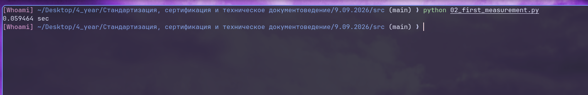
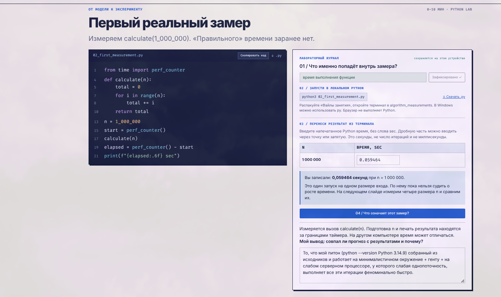

**Результат:** `0.059464 sec`.
**Вывод:** 
То, что мой питон, собранный из исходников и работающий на минималистичном окружении + Gentoo + на серверном процессоре (у которого слабая однопоточность), выполняет все эти итерации феноменально быстро — это факт. 0.05 секунды на миллион операций — отличный результат. 

---

## Пример 2: Эксперимент с ростом (x10)

**Что делал:** Увеличивал `n` в 10 раз и смотрел, как растет время.

**Скриншоты:**
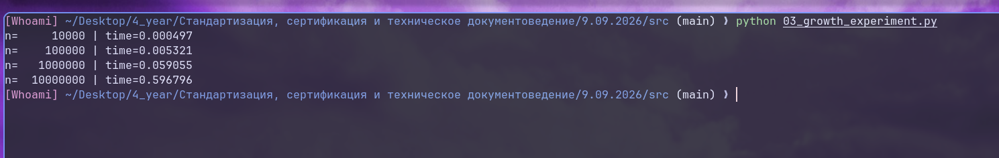
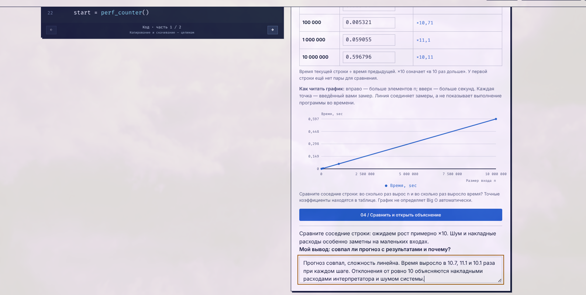

**Результат:**
*   n = 10 000: 0.000497
*   n = 100 000: 0.005321
*   n = 1 000 000: 0.059055
*   n = 10 000 000: 0.596796

**Вывод:** 
Прогноз совпал, сложность линейная. Время выросло в 10.7, 11.1 и 10.1 раза при каждом шаге. Отклонения от ровно ×10 объясняются накладными расходами интерпретатора и шумом системы. 

---

## Пример 3: Один запуск может обмануть (Медиана)

**Что делал:** Сделал 7 замеров подряд для `n = 1 000 000`, чтобы посмотреть на разброс.

**Скриншоты:**
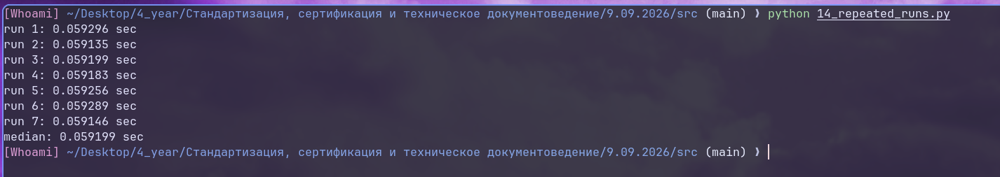


**Результат:** Разброс времени между запусками минимален (от 0.059135 до 0.059296 сек). Медиана: `0.059199 sec`.
**Вывод:** 
Разброс минимален. Это подтверждает, что фоновый шум системы сведен к минимуму, а окружение Gentoo и собранный Python очень стабильно держат результат. Медиана — отличная оценка, так как она устойчива к случайным выбросам, в отличие от среднего арифметического.

---

## Пример 4: Доступ к элементу списка (O(1))

**Что делал:** Проверял, зависит ли время доступа к середине списка от его размера (от 1 000 до 1 000 000).

**Скриншоты:**
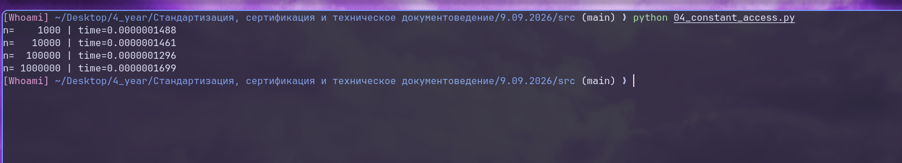
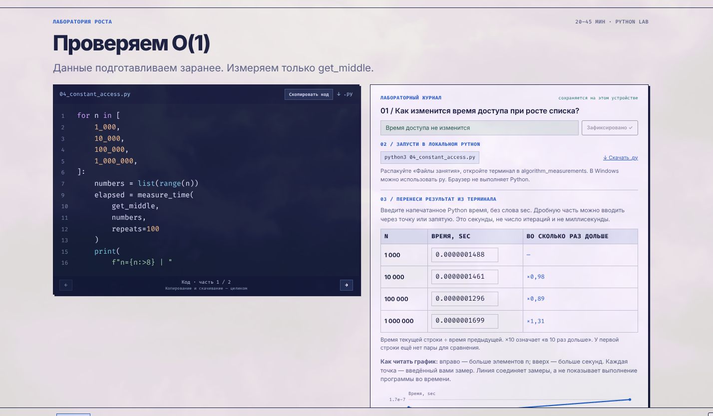
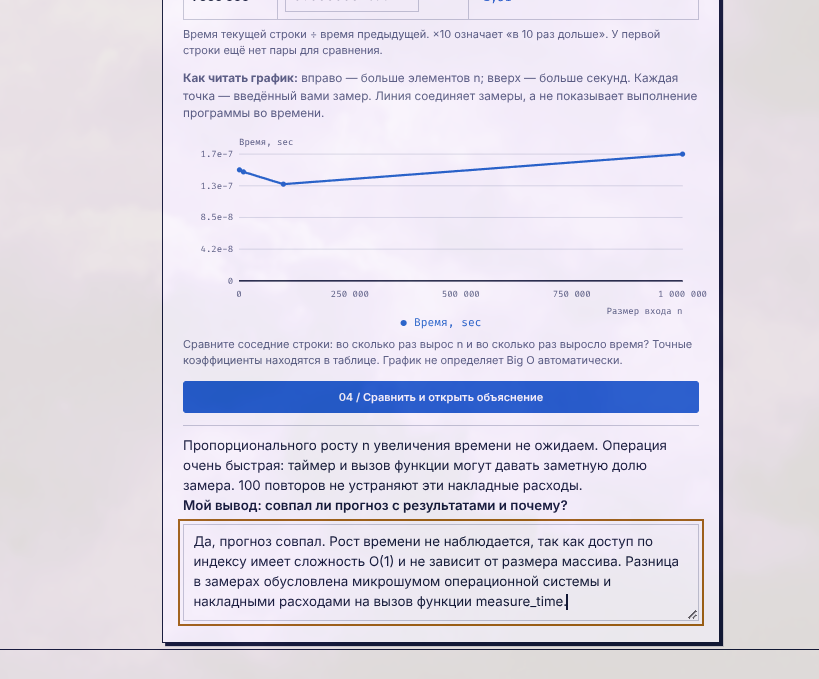
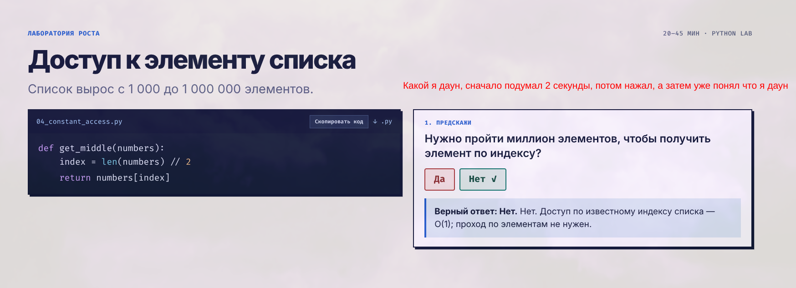
.png)

**Результат:** Время везде плавает в районе `0.00000014` сек. (Разница ×0.98, ×0.89, ×1.31).
**Вывод:** 
Да, прогноз совпал. Рост времени не наблюдается, так как доступ по индексу имеет сложность O(1) и не зависит от размера массива. Разница в замерах — микрошум ОС и накладные расходы на вызов функции `measure_time`. График получился практически горизонтальной линией.

---

## Пример 5: Линейный поиск (O(n))

**Что делал:** Искал отсутствующий элемент (`-1`) в списках разного размера. Худший случай.

**Скриншоты:**
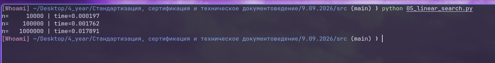
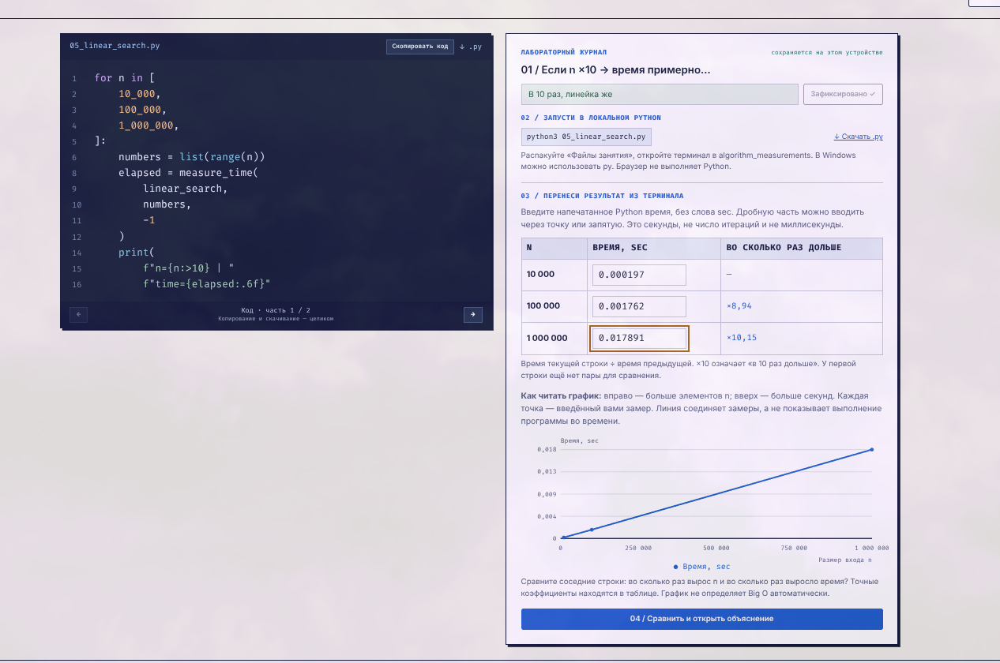
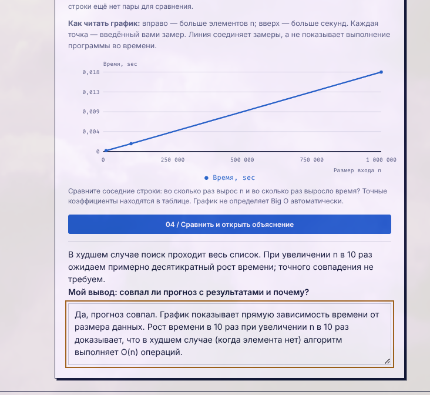
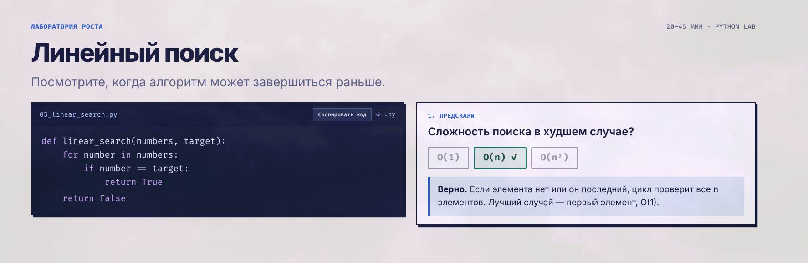

**Результат:**
*   n = 10 000: 0.000197
*   n = 100 000: 0.001762 (×8.94)
*   n = 1 000 000: 0.017891 (×10.15)

**Вывод:** 
Прогноз совпал. График показывает прямую зависимость времени от размера данных. Рост времени в ~10 раз при увеличении n в 10 раз доказывает, что в худшем случае (когда элемента нет) алгоритм выполняет O(n) операций. Точного совпадения до сотых здесь и не должно быть из-за фоновой нагрузки на ОС.

---

## Пример 6: Вложенные циклы (O(n²))

**Что делал:** Замерял квадратичный алгоритм (вложенные циклы), увеличивая `n` в 2 раза (100, 200, 400, 800).

**Скриншоты:**
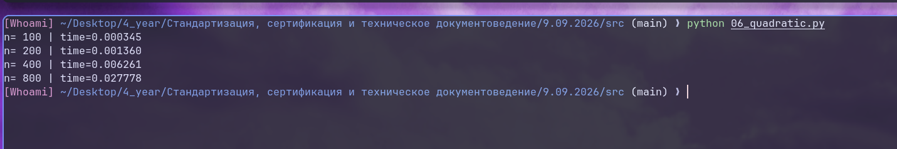
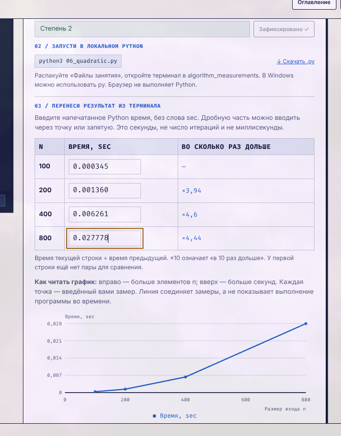
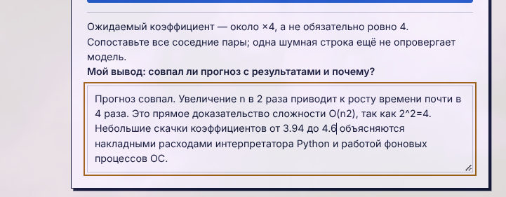
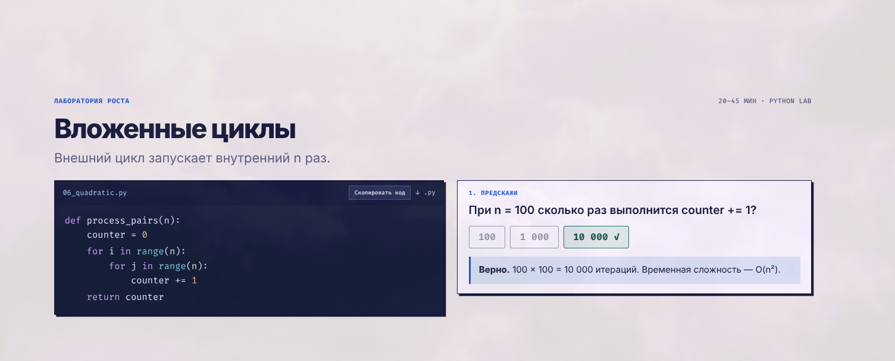
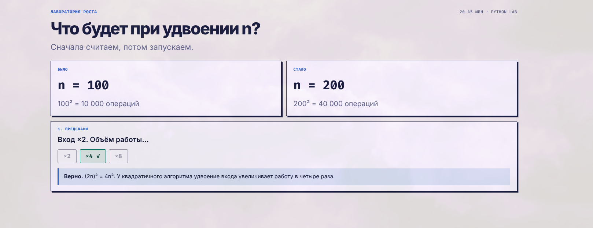

**Результат:** Время росло примерно в 4 раза (×3.94, ×4.6, ×4.44).
**Вывод:** 
Прогноз совпал. Увеличение n в 2 раза приводит к росту времени почти в 4 раза. Это прямое доказательство сложности O(n²), так как 2² = 4. Небольшие скачки коэффициентов объясняются накладными расходами интерпретатора Python и работой фоновых процессов ОС.

---

## Пример 7: Два O(n) — разная скорость (sum vs manual)

**Что делал:** Сравнивал ручной цикл суммирования и встроенную `sum()` на списке из 1 млн элементов.

**Скриншоты:**
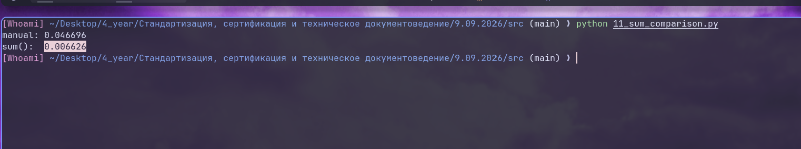
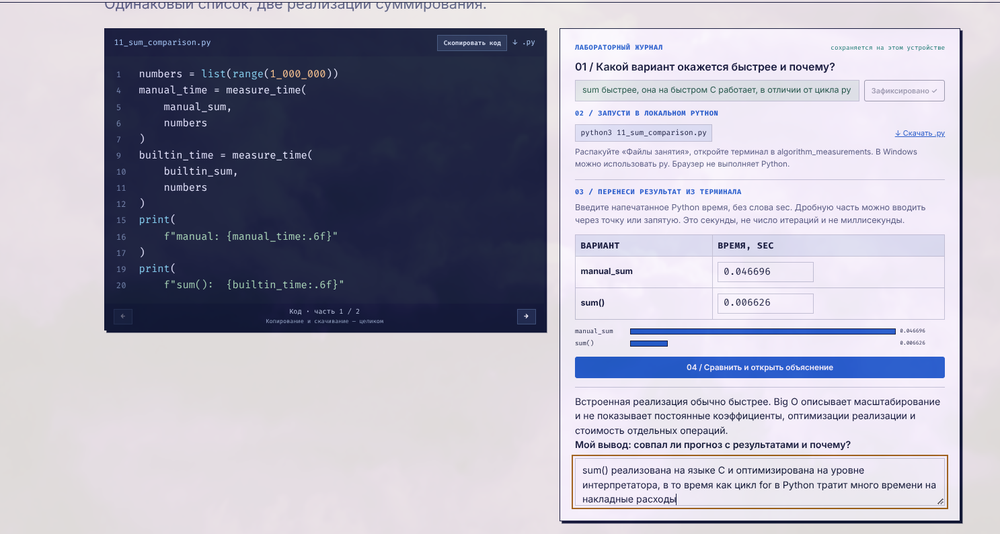

**Результат:** 
*   manual_sum: 0.046696
*   sum(): 0.006626
Встроенная функция быстрее примерно в 7 раз.

**Вывод:** 
`sum()` реализована на языке C и оптимизирована на уровне интерпретатора, в то время как цикл `for` в Python тратит много времени на накладные расходы на каждой итерации. Big O описывает масштабирование, но не показывает эти постоянные коэффициенты.

---

## Пример 8: Инженерная задача — миллион ID (list vs set)

**Что делал:** Проверял, что быстрее искать элемент — в списке или множестве. Данные подготавливал заранее, чтобы они не попали в замер.

**Скриншоты:**
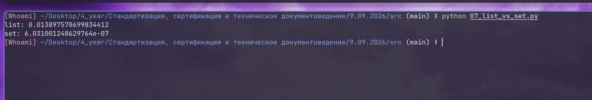
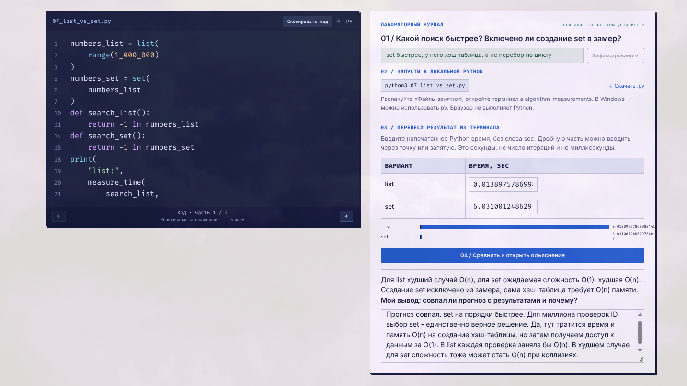

**Результат:**
*   list: 0.013897
*   set: 6.03e-07 (0.0000006)
`set` на порядки быстрее (почти в 23000 раз).

**Вывод:** 
`set` на порядки быстрее. Для миллиона проверок ID выбор `set` — единственно верное инженерное решение. Да, мы тратим время и память O(n) на создание хэш-таблицы, но затем получаем доступ к данным за O(1). В `list` каждая проверка заняла бы O(n), что при большом количестве запросов полностью «положило» бы сервер. В худшем случае для `set` сложность тоже может стать O(n) при коллизиях, но встроенные механизмы Python делают это крайне редким.

---

## Пример 9: Исследуем память (list vs on-the-fly)

**Что делал:** Сравнивал потребление памяти двух функций: одна сохраняет весь список квадратов, другая просто суммирует "на лету".

**Скриншоты:**
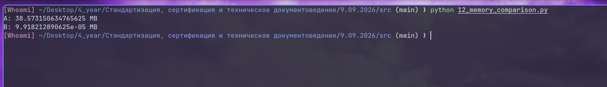
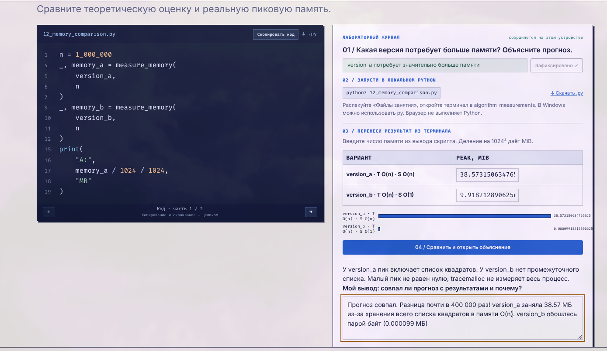
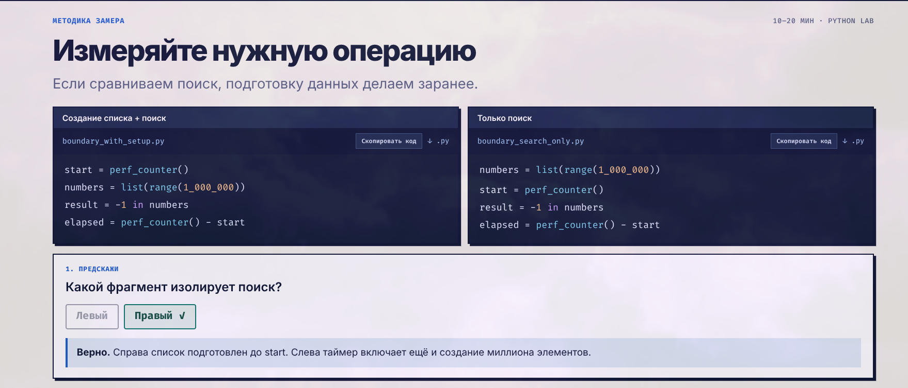

**Результат:**
*   version_a (с списком): 38.57 MB
*   version_b (без списка): 9.9e-05 MB (около 100 байт).

**Вывод:** 
Прогноз совпал. Разница почти в 400 000 раз! `version_a` заняла 38.57 МБ из-за хранения всего списка квадратов в памяти O(n). `version_b` обошлась парой байт (0.000099 МБ), так как хранит только итоговую сумму O(1). То, что `version_b` не показала ровно 0, объясняется тем, что `tracemalloc` замеряет накладные расходы самого Python (например, создание объекта цикла), но это несравнимо с затратами на целый список.

---

## Пример 10: list vs generator

**Что делал:** То же самое, что и в примере 9, но через синтаксис списковых включений `[...]` и генераторов `(...)`.

**Скриншот:**
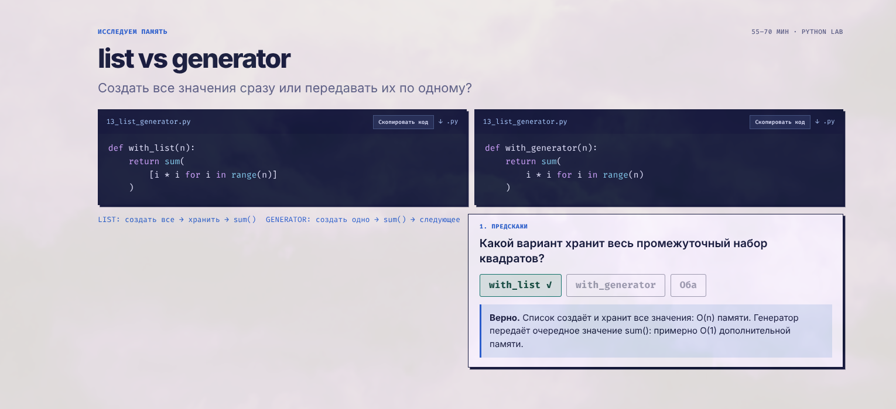

**Результат:** Список съел ~38 МБ, генератор — почти 0 МБ.
**Вывод:** 
Генераторы — это лучший выбор при обработке больших данных, если нам не нужно хранить все промежуточные результаты одновременно. Список создает всё сразу (O(n) памяти), а генератор передает по одному элементу (O(1) памяти).

---

## Финальная задача: Поиск дубликатов

**Что делал:** Два подхода к поиску дубликатов.
*   **Решение А (nested):** Вложенные циклы, сравниваем каждую пару. Время O(n²), Память O(1).
*   **Решение B (set):** Запоминаем встреченное в множество. Время O(n), Память O(n).

**Скриншоты (анализ и графики):**
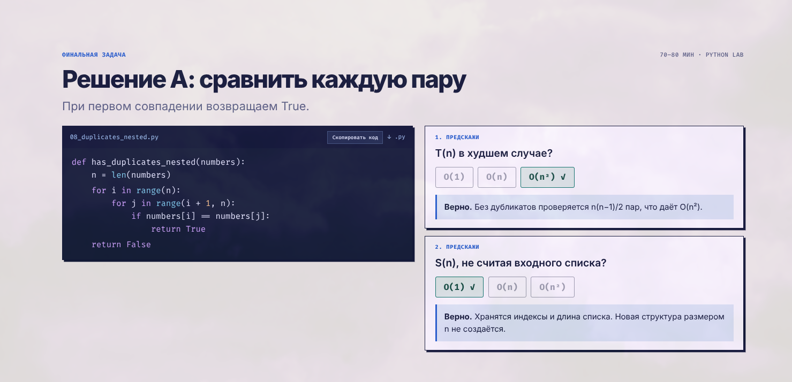
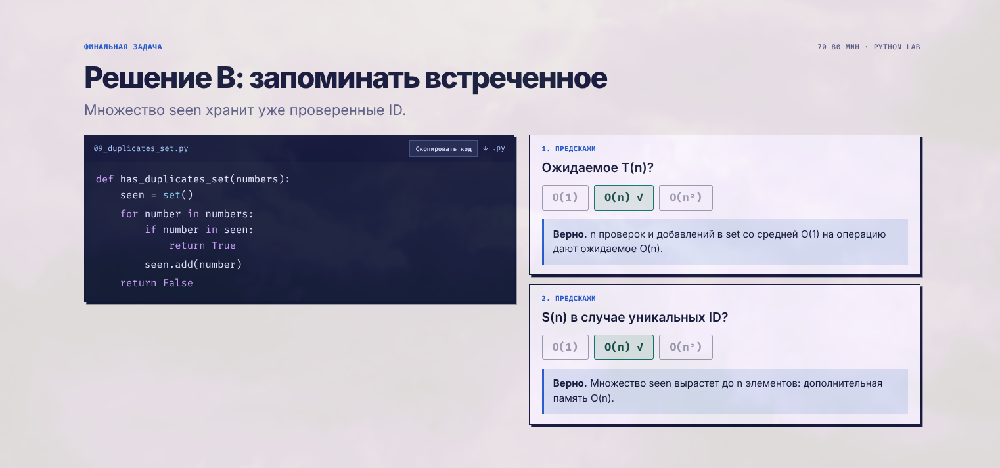

**Скриншоты финального эксперимента:**
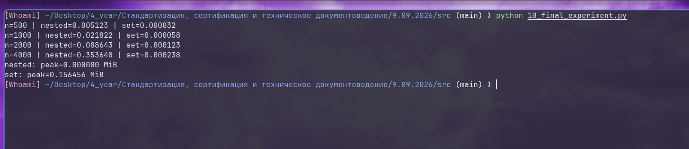
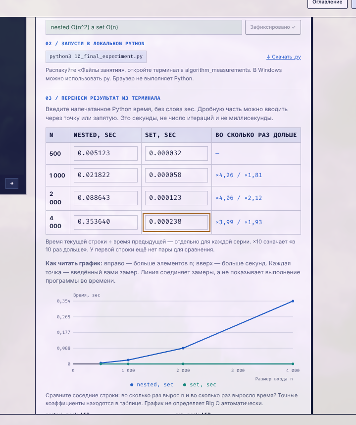
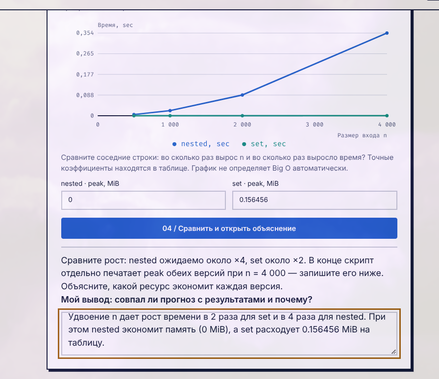
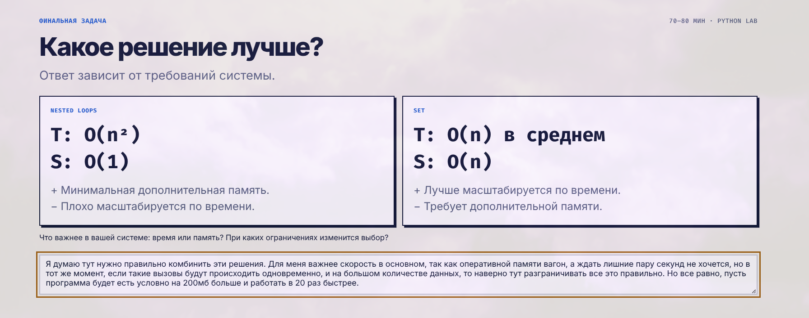


**Результаты:**
*   При удвоении n алгоритм `nested` замедлялся почти ровно в 4 раза (O(n²)), а `set` — всего в ~2 раза (O(n)).
*   При n=4000 разница в скорости достигла почти 1500 раз.
*   Пиковая память: `nested` — 0 MB, `set` — 0.156456 MB.

**Вывод:** 
Это наглядный пример **Space-Time Tradeoff** (обмен памяти на скорость). `nested` экономит память (O(1)), но катастрофически проигрывает во времени. `set` жертвует небольшим объемом оперативной памяти ради колоссального ускорения работы.

Что важнее в моей системе: время или память? Однозначно время. Оперативной памяти сейчас "вагон", а ждать лишние пару секунд (или минут при больших n) не хочется. Даже если программа будет есть условно на 200МБ больше, но работать в 20 раз быстрее — я выберу этот вариант. Единственное, если такие вызовы будут происходить одновременно (High Load) и на большом количестве данных, то квадратичный алгоритм просто повесит систему из-за 100% загрузки CPU. Поэтому в 99% случаев выбираем `set`.

---

## Итог
Все 10/10 навыков отработаны. Я убедился, что теория Big O — это база, но без реальных замеров (`perf_counter`, `tracemalloc`) невозможно увидеть скрытые константы (как разница между циклом и `sum()`) и понять, где программа начнет "жрать" память.
