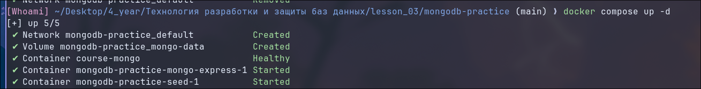
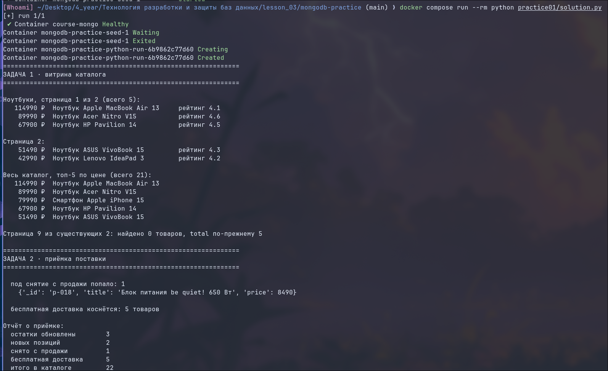
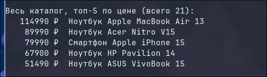
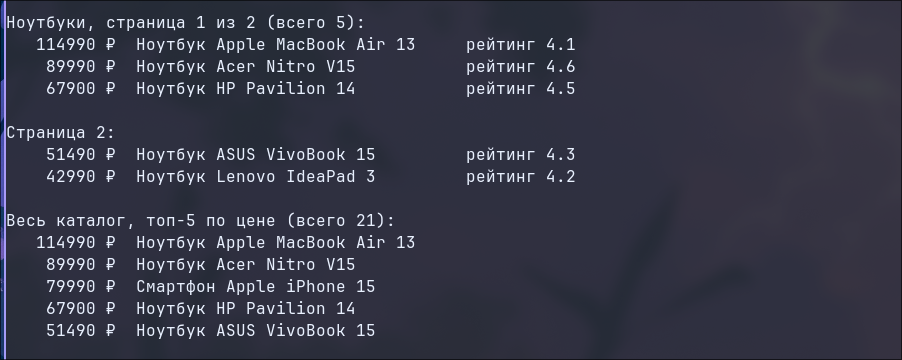
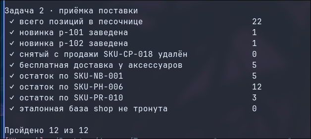
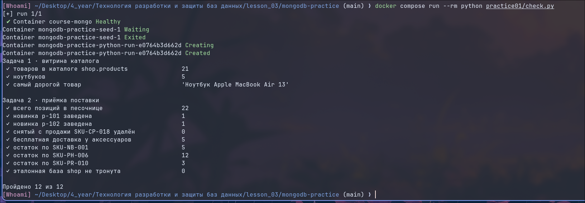

## Заполните отчёт

**ФИО:** Селиванов Матвей Сергеевич
**Группа:** 9/4-РПО-23/1
**Дата:** 30.10.2026

### Среда выполнения

- ОС: Gentoo Linux x86_64
- Язык и версия: Python 3.14.10
- MongoDB / Compass: MongoDB 7.0 (в Docker)
- База данных: `shop`
- Коллекция: `products`
- Команда запуска: `docker compose run --rm python practice01/solution.py`

### Результаты

В ходе работы был запущен учебный стенд в Docker. Скрипт `seed` загрузил в базу данных `shop` 21 товар. 
С помощью решения на Python были выполнены две задачи. В первой задаче (витрина каталога) был прочитан весь каталог, выполнен поиск с фильтрацией по категории «Ноутбуки» (найдено 5 товаров), применена пагинация (по 3 товара на страницу) и сортировка по цене. 
Во второй задаче (приёмка поставки) были обновлены остатки для 3 артикулов, добавлены 2 новые позиции (p-101 и p-102), удален 1 товар (SKU-CP-018) и применена бесплатная доставка к 5 аксессуарам. Итого в каталоге стало 22 позиции.
Скрипт самопроверки `check.py` подтвердил, что все данные в базе изменились корректно (Пройдено 12 из 12).

### Скриншоты

1. Запуск: 
2. Создание товаров: 
3. Каталог: 
4. Поиск: 
5. Изменение/удаление: 
6. Проверка в базе: 

### Ответы на вопросы

1. **Какие поля есть у документа товара? Какие поля должны иметь числовой тип и почему цену и количество нельзя хранить строками?**
   У документа товара есть поля: `_id`, `sku`, `title`, `category`, `price`, `rating`, `stock`. Поля `price` и `stock` (количество) обязательно должны быть числами. Если хранить их строками, то перестанут работать числовые операторы сравнения (например, `$lt`, `$gt` для поиска по цене) и сортировка. Строки сравниваются лексикографически, поэтому "100" будет считаться меньше "20".

2. **Чем обычное чтение коллекции отличается от поиска по условию? Приведите пример запроса или фрагмента кода из своей работы.**
   Обычное чтение (например, `db.products.find({})`) возвращает все документы коллекции. Поиск по условию использует фильтр, чтобы вернуть только подходящие документы. В моей работе в коде `solution.py` при поиске ноутбуков использовался фильтр: `query = {"category": "Ноутбуки"}`, и запрос `products.find(query)` вернул только 5 товаров из 21.

3. **Как вы проверили, что операция действительно изменила данные в MongoDB, а не только текст в интерфейсе программы?**
   Для этого использовался специальный скрипт проверки `check.py`. Он не смотрит на код программы, а напрямую подключается к базе данных MongoDB и проверяет фактическое состояние документов. Например, он проверил, что остаток по SKU-NB-001 стал равен 5, а новинка p-101 действительно появилась в коллекции. Успешное прохождение всех 12 проверок доказывает, что данные реально изменились в базе.

### Вывод

Я научился(ась) работать с MongoDB через драйвер Python, выполнять фильтрацию, сортировку, пагинацию, а также обновлять и удалять документы. Программа запускается в изолированном окружении Docker и успешно подключается к базе данных. В MongoDB проверено фактическое изменение документов с помощью скрипта самопроверки.
